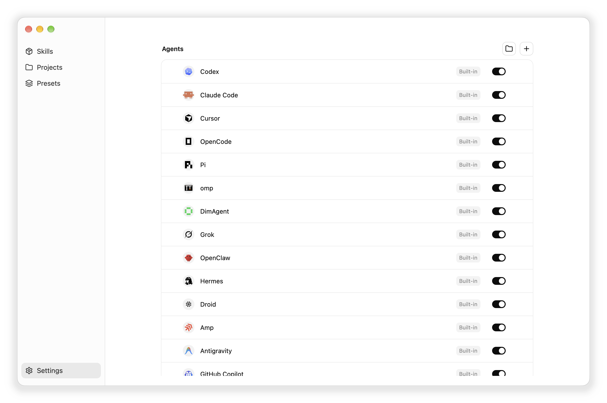
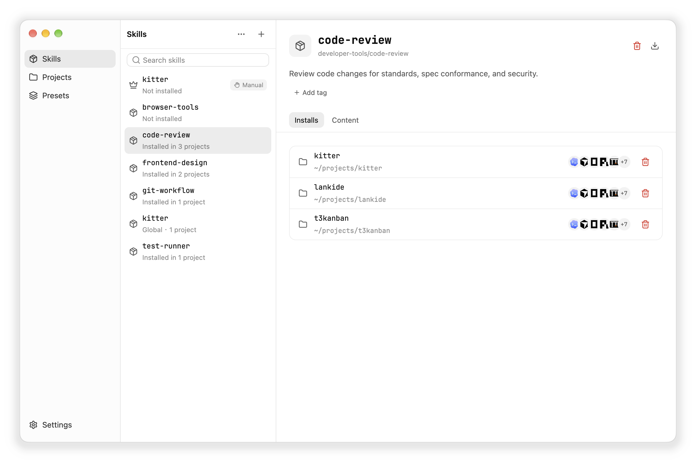
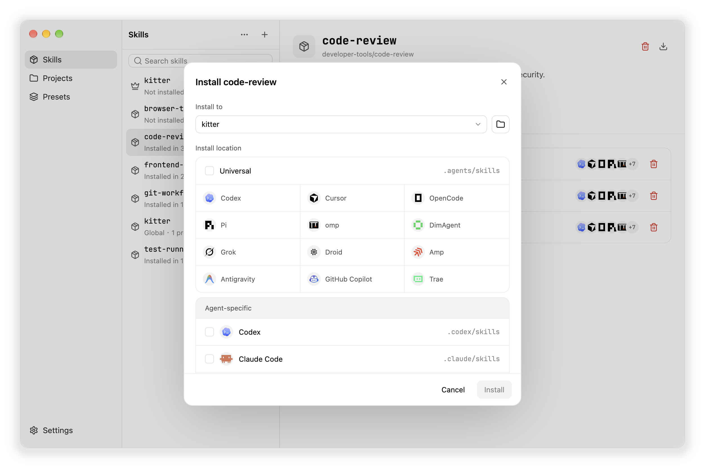
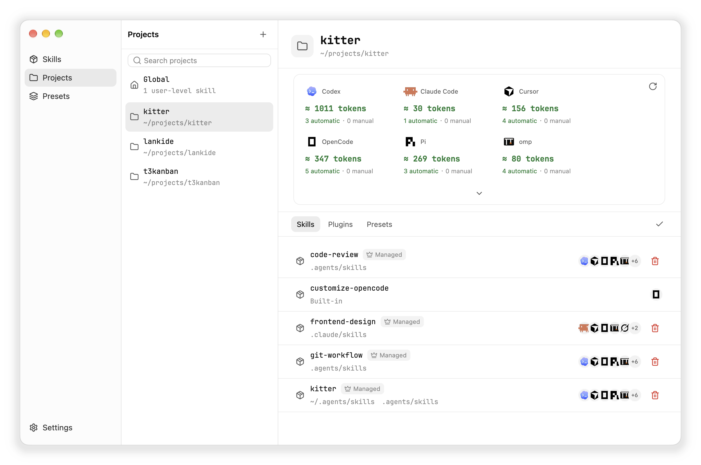
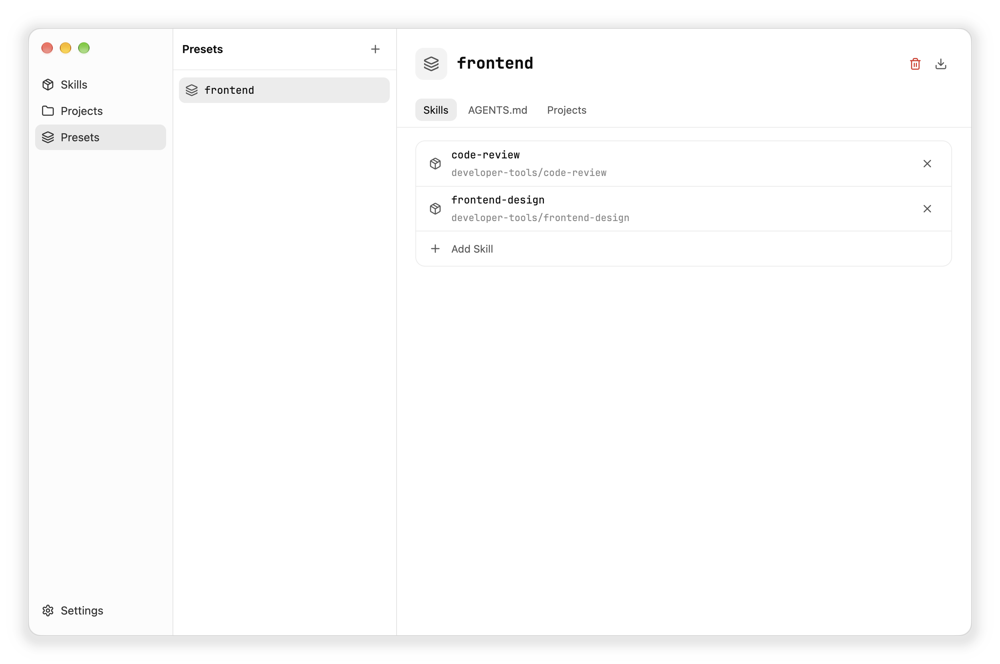

<p align="center">
  
</p>

<p align="center">
  <a href="./README.zh-CN.md">简体中文</a>
</p>

<p align="center">
  <a href="./LICENSE"></a>
  <a href="https://github.com/what1f/kitter/releases/latest"></a>
  
  
</p>

<p align="center"><strong>One skill library. Every project gets only what it needs.</strong></p>

Kitter is a desktop app and CLI for managing Agent Skills across projects. Keep your skills in one library, install the right combination for each project, and update them in one place.

Built entirely in Rust with GPUI, Kitter pairs a clean, responsive interface with instant startup, microscopic memory usage, and 60+ FPS native performance even when managing hundreds of skills.

<p align="center">
  
</p>

---

## Key Highlights

- **Maintain once, zero drift** — Projects link directly to maintained skill sources via managed links (symlinks/junctions). Update a skill once, and every project reflects the change immediately.
- **15+ built-in agents and open plugin engine** — Out-of-the-box support for mainstream AI coding agents, powered by an embedded QuickJS engine. Add or override any agent using simple single-file JavaScript plugins.
- **Effective skills and token cost auditing** — Automatically inspect project, parent directory, user-level, and plugin capabilities. Estimate prompt context token consumption per agent to keep your context lean.
- **Presets and non-destructive AGENTS.md** — Bundle curated skills and instruction rules into reusable presets. Injects instructions into `AGENTS.md` inside managed comment blocks without touching user notes.
- **Multi-source import and adoption** — Add skills from GitHub, skills.sh-compatible sources, Claude plugins, or local directories. Use `adopt` to scan and manage scattered pre-existing skills in place.
- **Native performance** — 100% Rust with a lightweight GPUI desktop interface and a dedicated standalone CLI built for terminals and CI automation.

---

## Supported Agent Ecosystem

Kitter natively respects the distinctive discovery rules, target directories, frontmatter schemas, and catalog token estimation formats of each agent:

| Category | Agents / Platforms |
| --- | --- |
| **Built-in Support** | **Claude Code** · **Cursor** · **Codex** · **OpenCode** · **GitHub Copilot** · **Antigravity** · **Grok** · **Pi** · **Oh My Pi (omp)** · **DimAgent** · **OpenClaw** · **Hermes** · **Droid** · **Amp** · **Trae** |
| **Universal Target** | `.agents/skills` (standard multi-agent shared directory) |
| **Custom Plugins** | Extendable to any proprietary or emerging agent via lightweight JavaScript plugins |

<p align="center">
  
</p>

### Extensible Agent Plugins

Easily define support for custom in-house agents or community tools (see the [Agent Plugins Guide](./docs/agent-plugins.md)):

```js
import { defineAgent, standard } from "kitter";

export default defineAgent({
  apiVersion: 1,
  id: "my-agent",
  name: "My Agent",
  reads: ["my-agent", "universal"],
  install: { project: ".my-agent/skills", global: "~/.my-agent/skills" },
  skills: standard.skills({
    project: [".my-agent/skills", ".agents/skills"],
    user: ["~/.my-agent/skills", "~/.agents/skills"],
  }),
});
```

Manage agents directly from desktop **Settings** or via `kitter agents` (add, remove, update, enable/disable, and reorder).

---

## Install Kitter

Download the prebuilt application from [GitHub Releases](https://github.com/what1f/kitter/releases/latest):

- **macOS (Apple Silicon / Intel)** — choose `macos-arm64.dmg` (Apple Silicon) or `macos-x86_64.dmg` (Intel), open the `.dmg` and drag `Kitter.app` into `Applications`.
  *(If macOS blocks first launch, confirm it was downloaded from the official release, then go to **System Settings → Privacy & Security → Open Anyway**, or run `xattr -dr com.apple.quarantine /Applications/Kitter.app`)*
- **Windows (x64)** — download `Kitter-<version>-desktop-windows-x86_64.exe` and run it directly (statically linked MSVC runtime, zero dependencies).
- **Linux (x64)** — extract `Kitter-<version>-desktop-linux-x86_64.tar.gz` and run `./Kitter` from the extracted directory.

> **Standalone CLI**: The desktop app and CLI share the same core but are released as separate artifacts. Standalone `kitter` CLI binaries for macOS, Windows, and Linux are available directly on the Releases page.

---

## Manage your skills with Kitter

### 1. Build one library

Use **+** to add skills from a local folder, GitHub or a skills.sh-compatible source, or a Claude plugin source. If skills are already scattered across projects, choose **Existing installations** to inspect and adopt them without moving their source directories.

Kitter keeps one maintained source for each skill. Open its **Installs** tab to immediately see every project using it, every installation location, and the agents that can discover it.

<p align="center">
  
</p>

### 2. Install only where needed

Select a skill, choose a project, then install it into the shared `.agents/skills` directory or an agent-specific directory. Kitter creates managed links instead of independent copies, so projects can use different combinations without creating update drift. Skills you use across all projects can also be installed at the user level.

<p align="center">
  
</p>

### 3. Verify what is actually active

Open **Projects** to see the complete effective skill set for every agent—not just installations managed by Kitter. The view discovers project, parent, user-level, built-in, and plugin-provided capabilities, then shows where each one came from.

The per-agent token estimate helps you spot skills that add unnecessary context overhead.

<p align="center">
  
</p>

### 4. Reuse a setup with presets

A preset bundles skills with optional `AGENTS.md` instructions. Open **Presets** to build one, then install it into a project in one step. Kitter appends the preset's instructions to the project's `AGENTS.md` inside a managed block and leaves your own content untouched.

When you change a preset, its projects show that they need a sync, and you choose when to apply it. Removing a preset from a project removes only what it installed.

<p align="center">
  
</p>

```bash
kitter preset create frontend
kitter preset add frontend react typescript
kitter preset install frontend --project /path/to/project --target universal
kitter preset sync frontend
```

### 5. Update once

Run **Check for updates** from the desktop app or use `kitter check` and `kitter update`. Every managed project continues to use the same maintained source.

---

## CLI Quick Reference

```bash
# 1. Skill Library Management
kitter add npx https://github.com/owner/repository --skill skill-a  # Add skill from repository
kitter list                                                        # List managed skills
kitter update --all                                                # Update all skills
kitter adopt --all                                                 # Discover & adopt scattered skills

# 2. Project Installation
kitter install skill-a --project /path/to/project --target universal # Install to project
kitter project /path/to/project                                      # Inspect effective skills & tokens
kitter uninstall skill-a --project /path/to/project                 # Remove skill installation

# 3. Presets
kitter preset create frontend                                      # Create a preset
kitter preset add frontend react typescript                        # Add skills to preset
kitter preset install frontend --project /path/to/project          # Install preset to project
kitter preset sync frontend                                        # Sync preset changes

# 4. Agent Plugins Management
kitter agents                                                      # List agents & plugin health
kitter agents add https://github.com/owner/repo                    # Add agent plugin from git
kitter agents enable <id> / disable <id>                           # Enable or disable an agent
kitter agents move <id> --before <other-id>                        # Reorder agents
```

---

## Standalone CLI and agent skill

You do not need the desktop app to use Kitter. Download the standalone CLI from [GitHub Releases](https://github.com/what1f/kitter/releases/latest), put `kitter` on your `PATH`, and install the [`$kitter` skill](./resources/skills/kitter) directly:

```bash
npx skills add what1f/kitter --skill kitter
```

The skill lets an agent inspect the current machine, add or adopt skill sources, install the right project combination, and verify the result through the standalone `kitter` CLI. If the CLI is missing, the skill can guide you through downloading it from an official Release.

---

## Local data

Kitter stores configuration and source records in the operating system's application-data directory. Skill contents live in the library directory:

| Platform | Default skill library |
| --- | --- |
| **macOS** | `~/Library/Application Support/Kitter/skills` |
| **Windows** | `%LOCALAPPDATA%\Kitter\skills` |
| **Linux** | `$XDG_DATA_HOME/Kitter/skills` or `~/.local/share/Kitter/skills` |

View or change the location with `kitter library` and `kitter library --set /absolute/path`.

---

## Build from source

<details>
<summary><strong>Build instructions</strong></summary>

```bash
git clone https://github.com/what1f/kitter.git
cd kitter

# Launch desktop app
cargo run --release --locked --features desktop --bin kitter-desktop

# Build standalone CLI
cargo build --release --locked --bin kitter
```

</details>

---

## Contributing

Issues and pull requests are welcome. Please open an [issue](https://github.com/what1f/kitter/issues) before starting a large behavioral or UI change so the scope can be aligned first.

If Kitter makes your skill setup calmer, consider [starring the repository](https://github.com/what1f/kitter). It helps more multi-project developers find it.

## License

Kitter is available under the [Apache License 2.0](./LICENSE). Licenses for bundled fonts, icons, and other third-party material are listed in [THIRD_PARTY_LICENSES.md](./THIRD_PARTY_LICENSES.md).

## Star History

<a href="https://www.star-history.com/?repos=what1f%2Fkitter&type=date">
  <picture>
    <source media="(prefers-color-scheme: dark)" srcset="https://api.star-history.com/chart?repos=what1f/kitter&type=date&theme=dark" />
    <source media="(prefers-color-scheme: light)" srcset="https://api.star-history.com/chart?repos=what1f/kitter&type=date" />
    
  </picture>
</a>
