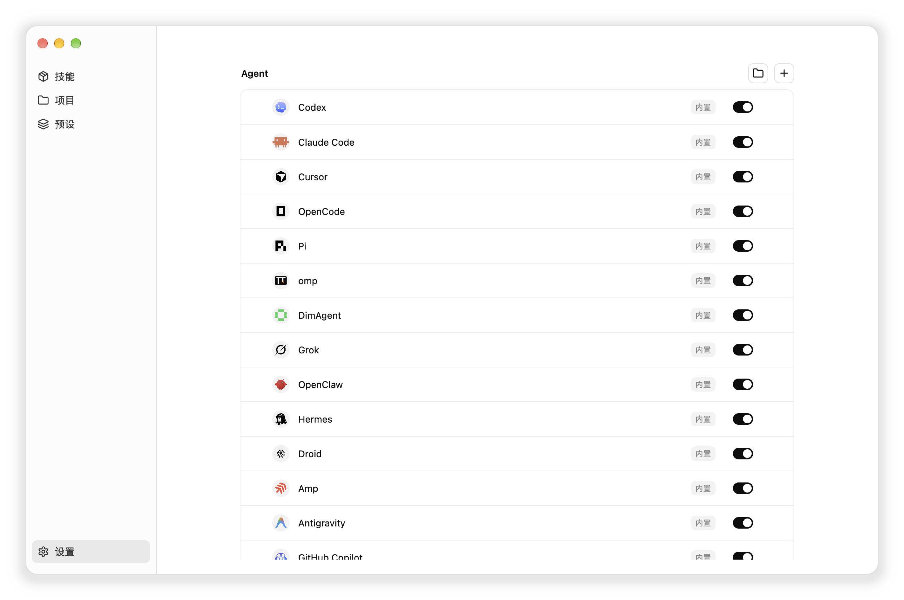
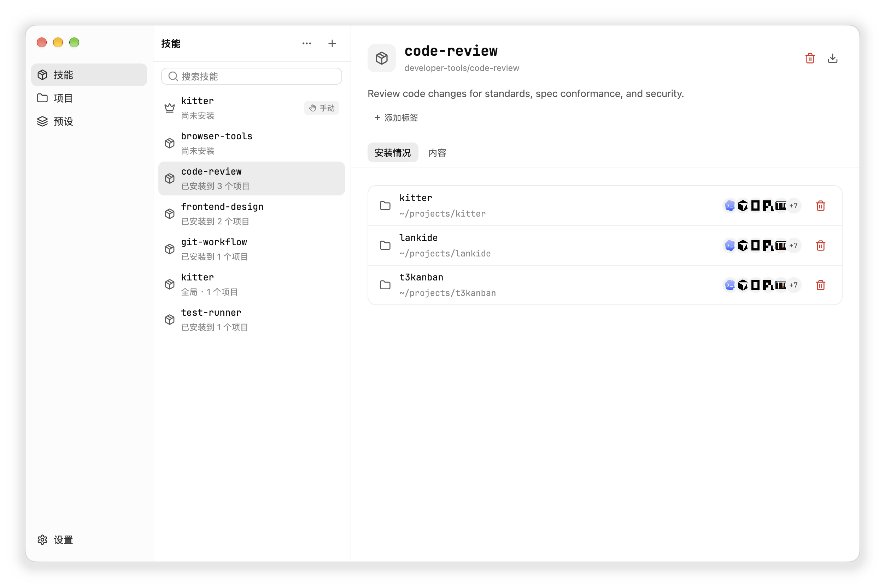
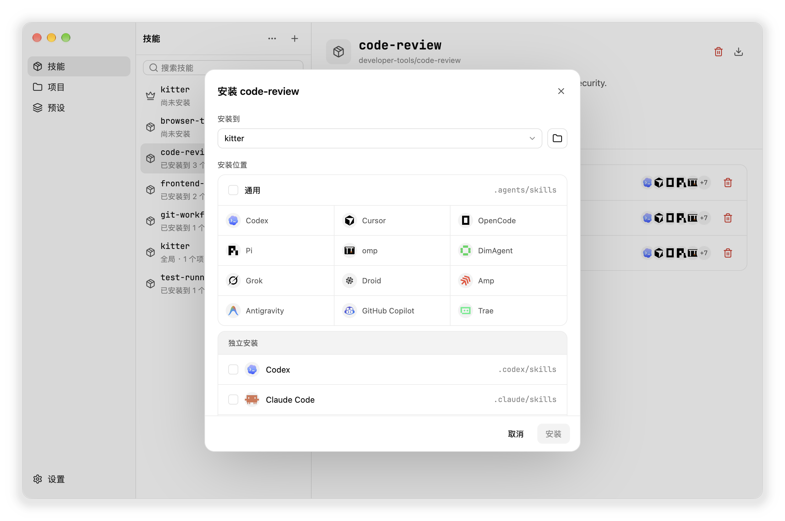
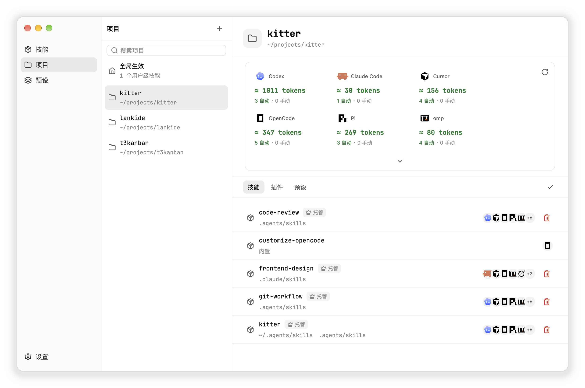
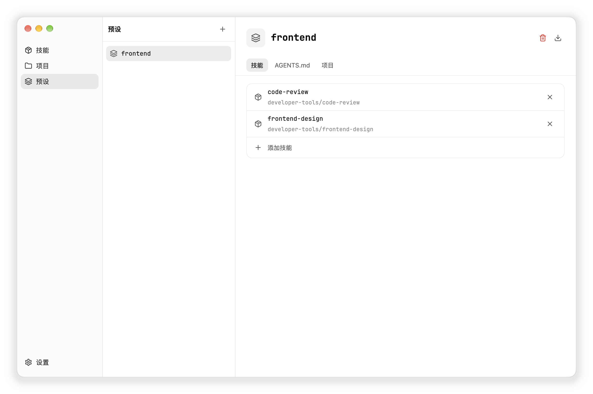

<p align="center">
  
</p>

<p align="center">
  <a href="./README.md">English</a>
</p>

<p align="center">
  <a href="./LICENSE"></a>
  <a href="https://github.com/what1f/kitter/releases/latest"></a>
  
  
</p>

<p align="center"><strong>一套 Skill 仓库，让每个项目只获得自己需要的 Skill。</strong></p>

Kitter 是一个管理 Agent Skill 的桌面应用和 CLI。它将分散在各处的 Skill 集中在一套标准仓库中，通过托管链接精准分发给不同项目的各种 AI Agent，实现一次维护、全局同步。

完全使用 Rust 与 GPUI 原生构建，启动瞬时、体积小、资源占用极低，即使管理大量 Skill 也能保持流畅的 60+ FPS 原生性能。

<p align="center">
  
</p>

---

## 核心亮点

- **单源维护，零复制漂移** — 项目与全局安装均通过托管链接指向统一来源，在 Kitter 中一处更新，所有关联项目立即生效。
- **15+ 原生 Agent 支持与开放插件生态** — 开箱即用支持主流 AI 编程 Agent；内置基于 QuickJS 的插件引擎，使用单文件 JavaScript 即可轻松扩展或自定义任何 Agent。
- **生效能力全景透视 & 上下文开销估算** — 深度扫描项目级、父级目录、全局及插件提供的实际生效 Skill，精确估算各 Agent 的 Prompt Token 消耗，告别上下文臃肿。
- **预设（Presets）与 AGENTS.md 规范注入** — 将技术栈常用 Skill 与团队提示词规范打包为预设，一键装入项目；自动以非侵入方式写入 `AGENTS.md`，支持平滑同步。
- **多渠道导入与存量纳管** — 支持从 GitHub、skills.sh 规范、Claude 插件市场或本地目录导入；提供 `adopt` 功能一键扫描纳管机器中分散的现有 Skill。
- **原生极致性能** — 纯 Rust 打造，体积小巧、界面清爽，支持 macOS、Windows、Linux 三大平台，并提供专为自动化设计的独立 CLI。

---

## 支持的 Agent 生态

Kitter 原生适配不同 Agent 各自独特的 Skill 发现目录、配置规范与 Token 统计格式：

| 类别 | 支持的 Agent / 工具 |
| --- | --- |
| **原生内置支持** | **Claude Code** · **Cursor** · **Codex** · **OpenCode** · **GitHub Copilot** · **Antigravity** · **Grok** · **Pi** · **Oh My Pi (omp)** · **DimAgent** · **OpenClaw** · **Hermes** · **Droid** · **Amp** · **Trae** |
| **通用共享目录** | `.agents/skills`（符合跨 Agent 通用规范的工具集） |
| **自定义扩展** | 支持编写轻量 JavaScript 插件支持任意团队自研或新兴 Agent |

<p align="center">
  
</p>

### 插件化扩展能力

通过单个 JavaScript 模块即可为任意 Agent 编写定义（详见 [Agent 插件开发指南](./docs/agent-plugins.zh-CN.md)）：

```js
import { defineAgent, standard } from "kitter";

export default defineAgent({
  apiVersion: 1,
  id: "my-agent",
  name: "My Agent",
  reads: ["my-agent", "universal"],
  install: { project: ".my-agent/skills", global: "~/.my-agent/skills" },
  skills: standard.skills({
    project: [".my-agent/skills", ".agents/skills"],
    user: ["~/.my-agent/skills", "~/.agents/skills"],
  }),
});
```

支持在设置页或通过 `kitter agents` 命令进行安装、更新、启停和排序管理。

---

## 安装 Kitter

从 [GitHub Releases](https://github.com/what1f/kitter/releases/latest) 下载适合您操作系统的桌面应用：

- **macOS（Apple Silicon / Intel）** — Apple Silicon 选择 `macos-arm64.dmg`，Intel 选择 `macos-x86_64.dmg`，打开后将 `Kitter.app` 拖入 `Applications`。
  *(如首次启动被 macOS 阻止，可前往 **系统设置 → 隐私与安全 → 仍要打开**，或在终端执行 `xattr -dr com.apple.quarantine /Applications/Kitter.app`)*
- **Windows（x64）** — 下载 `Kitter-<version>-desktop-windows-x86_64.exe`，直接运行（静态链接 MSVC 运行库，无外部依赖）。
- **Linux（x64）** — 解压 `Kitter-<version>-desktop-linux-x86_64.tar.gz`，进入解压后的目录运行 `./Kitter`。

> **独立 CLI**：桌面应用和 CLI 共用同一套核心，但作为两个独立产物发布。GitHub Releases 提供 macOS、Windows 和 Linux 的独立 CLI 包；内置 Kitter Skill 会查找该独立 CLI，并在缺失时引导你下载。

---

## 使用 Kitter 管理 Skill

### 1. 建立一套 Skill 仓库

点击 **+** 从本地目录、GitHub、兼容 skills.sh 的地址或 Claude 插件添加 Skill。如果 Skill 已经散落在多个项目中，可以选择 **已有安装**，在不搬动源目录的前提下检查并纳管它们。

Kitter 为每个 Skill 保留一份长期维护的来源。打开它的 **安装情况**，就能立即看到哪些项目正在使用它、每个安装位置，以及哪些 Agent 可以发现它。

<p align="center">
  
</p>

### 2. 只安装到需要的项目

选中一个 Skill 和目标项目，再选择共享的 `.agents/skills` 目录或指定 Agent 的私有目录。Kitter 建立托管链接，而不是复制出互不相关的副本，因此每个项目都可以拥有自己的 Skill 组合，同时保持来源一致。通用 Skill 也可以安装到用户级全局目录。

<p align="center">
  
</p>

### 3. 验证实际生效内容与 Token 开销

打开 **项目**，可以看到每个 Agent 完整的生效 Skill 集合，而不只是 Kitter 托管的安装。Kitter 会发现项目级、上级目录、用户级、内置及插件提供的能力，并标明每一项来自哪里。

每个 Agent 的 Token 估算可以帮助你发现不必要的 Skill 上下文开销。

<p align="center">
  
</p>

### 4. 用预设复用一套配置

预设把一组 Skill 和可选的 `AGENTS.md` 指令打包在一起。在 **预设** 中创建后，可一键安装到项目。Kitter 会把预设的指令追加到项目 `AGENTS.md` 的托管区块中，不会改动你自己写的内容。

修改预设后，相关项目会显示需要同步，由你决定何时应用。从项目移除预设时，只会移除它安装的内容。

<p align="center">
  
</p>

```bash
kitter preset create frontend
kitter preset add frontend react typescript
kitter preset install frontend --project /path/to/project --target universal
kitter preset sync frontend
```

### 5. 只更新一次

在桌面应用中执行 **检查更新**，或使用 `kitter check` 和 `kitter update`。所有托管项目会继续使用同一份维护来源。

---

## CLI 快速参考

```bash
# 1. 基础仓库管理
kitter add npx https://github.com/owner/repository --skill skill-a  # 从源添加 Skill
kitter list                                                        # 列出所有纳管 Skill
kitter update --all                                                # 更新所有 Skill
kitter adopt --all                                                 # 扫描并纳管现有 Skill

# 2. 项目与安装
kitter install skill-a --project /path/to/project --target universal # 安装到项目通用目录
kitter project /path/to/project                                      # 检查生效能力与 Token 开销
kitter uninstall skill-a --project /path/to/project                 # 卸载项目中的 Skill

# 3. 预设管理
kitter preset create frontend                                      # 创建预设
kitter preset add frontend react typescript                        # 预设添加 Skill
kitter preset install frontend --project /path/to/project          # 将预设安装到项目
kitter preset sync frontend                                        # 同步预设最新内容

# 4. Agent 插件管理
kitter agents                                                      # 查看 Agent 列表及插件状态
kitter agents add https://github.com/owner/repo                    # 添加第三方 Agent 插件
kitter agents enable <id> / disable <id>                           # 启用或停用 Agent
kitter agents move <id> --before <other-id>                        # 调整 Agent 排序
```

---

## 独立 CLI 与 Agent Skill

使用 Kitter 不要求安装桌面应用。你可以从 [GitHub Releases](https://github.com/what1f/kitter/releases/latest) 下载独立 CLI，将 `kitter` 放入 `PATH`，然后直接安装 [`$kitter` Skill](./resources/skills/kitter)：

```bash
npx skills add what1f/kitter --skill kitter
```

这个 Skill 让 Agent 可以通过独立的 `kitter` CLI 盘点当前机器、添加或纳管 Skill 来源、为项目安装正确组合并验证结果。缺少 CLI 时，它会引导你从官方 Release 下载。

---

## 本地数据存储

Kitter 将配置和来源记录保存在操作系统的应用数据目录，Skill 内容保存在仓库目录：

| 平台 | 默认 Skill 仓库 |
| --- | --- |
| **macOS** | `~/Library/Application Support/Kitter/skills` |
| **Windows** | `%LOCALAPPDATA%\Kitter\skills` |
| **Linux** | `$XDG_DATA_HOME/Kitter/skills` 或 `~/.local/share/Kitter/skills` |

使用 `kitter library` 和 `kitter library --set /absolute/path` 查看或修改位置。

---

## 从源码构建

<details>
<summary><strong>构建说明</strong></summary>

```bash
git clone https://github.com/what1f/kitter.git
cd kitter

# 运行桌面应用
cargo run --release --locked --features desktop --bin kitter-desktop

# 构建独立 CLI
cargo build --release --locked --bin kitter
```

</details>

---

## 参与贡献

欢迎提交 Issue 和 Pull Request。如果准备进行较大的行为或 UI 改动，请先创建 [Issue](https://github.com/what1f/kitter/issues) 对齐范围。

如果 Kitter 让你的 Skill 管理变得更从容，欢迎为 [项目点一颗 Star](https://github.com/what1f/kitter)，让更多同时维护多个项目的开发者看到它。

## 许可证

Kitter 使用 [Apache License 2.0](./LICENSE) 开源。内置字体、图标及其他第三方素材的许可证见 [THIRD_PARTY_LICENSES.md](./THIRD_PARTY_LICENSES.md)。

## Star History

<a href="https://www.star-history.com/?repos=what1f%2Fkitter&type=date">
  <picture>
    <source media="(prefers-color-scheme: dark)" srcset="https://api.star-history.com/chart?repos=what1f/kitter&type=date&theme=dark" />
    <source media="(prefers-color-scheme: light)" srcset="https://api.star-history.com/chart?repos=what1f/kitter&type=date" />
    
  </picture>
</a>
